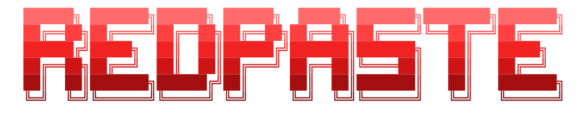

<div align="center">



### Encrypted on your device. Readable only by whoever holds the link.

RedPaste is an anonymous, end-to-end encrypted pastebin. Your paste is
encrypted in the browser before it ever leaves, and the server only ever stores
ciphertext. No accounts, no logins, no trackers.


</div>

---

RedPaste ships as a single self-contained binary with the frontend embedded:
one process, embedded SQLite by default, nothing else to run.

Use it to:

- Share code or text, always end-to-end encrypted, AES-256-GCM
- Set burn-after-read, view limits, expiry, and optional passphrases
- Collaborate in real time on an encrypted pasteboard (CRDT-based)
- Diff two texts or two existing pastes, computed entirely client-side
- Get syntax highlighting for 30+ languages with automatic detection
- Run the whole thing as one binary, or in Docker, with SQLite or Postgres

## Contents

- [Quick start](#quick-start)
- [Run it](#run-it)
- [Configuration](#configuration)
- [Security model](#security-model)
- [Project layout](#project-layout)
- [Build from source](#build-from-source)
- [License](#license)

## Quick start

**Prebuilt binary (Linux, macOS):**

```bash
curl -fsSL https://raw.githubusercontent.com/720pixel/RedPaste/main/install.sh | sh
redpaste-server
```

Open http://localhost:8080. The script picks the binary for your OS and CPU
(amd64 or arm64) from the [latest release](https://github.com/720pixel/RedPaste/releases/latest),
checks it against `checksums.txt` and installs it to `~/.local/bin`. Set
`BINDIR` to install elsewhere and `VERSION=v1.0.0` to pin a release. The server
keeps `redpaste.db` and its `.redpaste-pepper` key in the directory you start it
from; set `REDPASTE_SQLITE_PATH` to put them somewhere else.

On Windows, download `redpaste-server_windows_amd64.exe` from the release page
and run it.

**Docker, one command:**

```bash
docker run -d -p 8080:8080 -v redpaste:/data ghcr.io/720pixel/redpaste:latest
```

Open http://localhost:8080. The `redpaste` volume keeps your data (and an
auto-generated capability key) across restarts.

To build the image yourself instead of pulling it:

```bash
git clone https://github.com/720pixel/RedPaste.git
cd RedPaste
docker build -t redpaste .
docker run -d -p 8080:8080 -v redpaste:/data redpaste
```

## Run it

### Docker Compose

A small production stack (RedPaste + Postgres), built from this checkout.
Production mode refuses to start without a pepper and an https base URL:

```bash
export REDPASTE_SERVER_PEPPER=$(openssl rand -hex 32)
export REDPASTE_BASE_URL=https://paste.example.com
docker compose up -d
```

Put a TLS reverse proxy in front that serves that origin and forwards to port
8080; `deploy/nginx` has an example. To try the stack on plain
http://localhost:8080 first, also `export REDPASTE_DEV_INSECURE=1` and leave
`REDPASTE_BASE_URL` unset.

### From source

You'll need Go 1.25+ and Node 20+ (Node only builds the frontend; it isn't
needed at runtime).

```bash
make build   # builds the frontend and embeds it into the binary
./redpaste-server
```

Or run in dev mode with SQLite:

```bash
make dev
```

## Configuration

Everything is configured through `REDPASTE_*` environment variables. See
[`.env.example`](.env.example) for the full list with comments. The
essentials:

| Variable | Purpose | Default |
|---|---|---|
| `REDPASTE_BASE_URL` | Canonical public origin | `http://localhost:8080` |
| `REDPASTE_LISTEN_ADDR` | Listen address | `:8080` |
| `REDPASTE_DATABASE_URL` | Postgres DSN (empty = embedded SQLite) | *(empty)* |
| `REDPASTE_SERVER_PEPPER` | HMAC pepper for capability hashing (≥32 bytes in prod) | *(dev ephemeral)* |

Generate a pepper with `openssl rand -hex 32`.

## Security model

Your browser encrypts before upload. The server stores encrypted data and
never receives the decryption secret in your share link. Anyone with the
complete link can read or edit the paste according to its access type.
RedPaste **cannot** recover lost keys or passphrases, prevent screenshots, or
delete copies a recipient already saved.

See [`docs/threat-model.md`](docs/threat-model.md) for the full threat model,
[`docs/security/ddos.md`](docs/security/ddos.md) for the abuse/DDoS posture,
and [`SECURITY.md`](SECURITY.md) to report a vulnerability.

## Project layout

```
cmd/redpaste-server   the server binary
internal/             backend packages (config, store, crypto, http, live, …)
web/                  React + Vite frontend (built into the binary)
migrations/           reserved for versioned migrations; schema is currently
                      inline in internal/sqlite and internal/postgres
deploy/               nginx, systemd, docker, compose
docs/                 ADRs, threat model, security notes
```

## Build from source

```bash
git clone https://github.com/720pixel/RedPaste.git
cd RedPaste
make build
./redpaste-server
```

`make test` runs the Go test suite; `cd web && npm test` runs the frontend
suite.

## License

[MIT](LICENSE).
